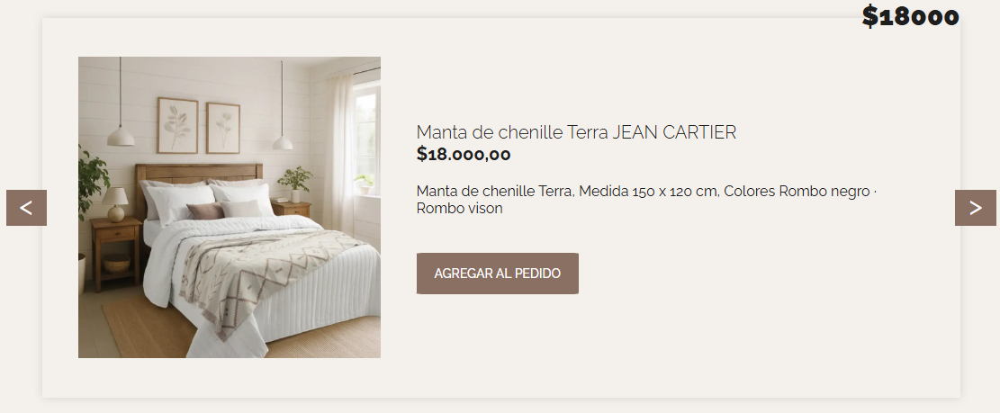
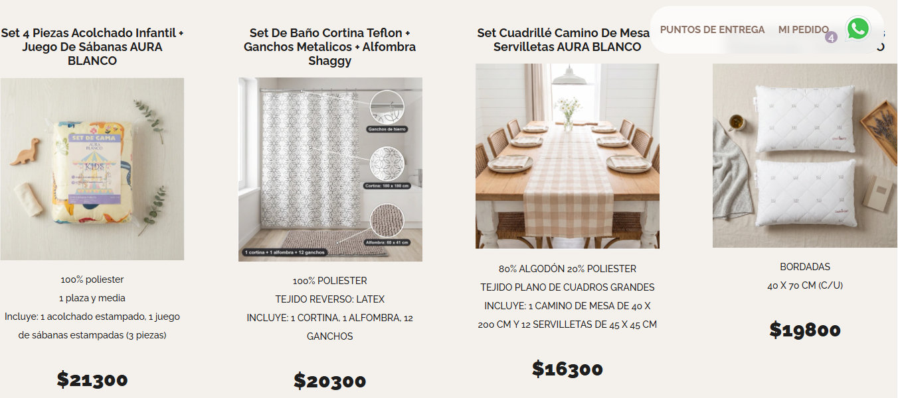
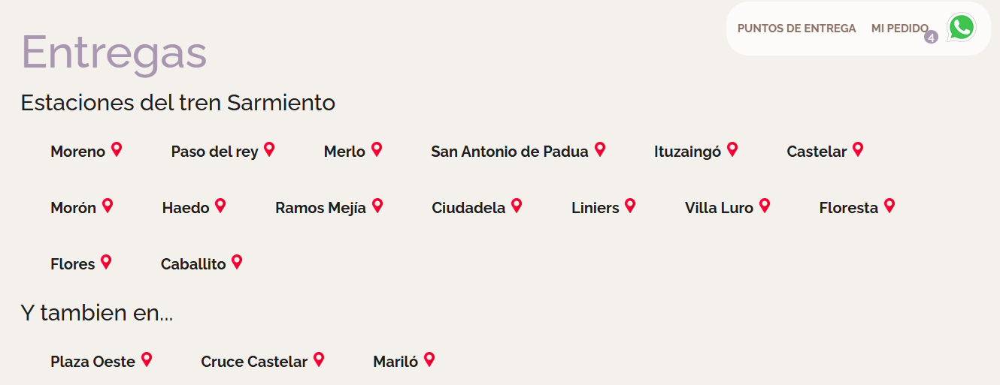
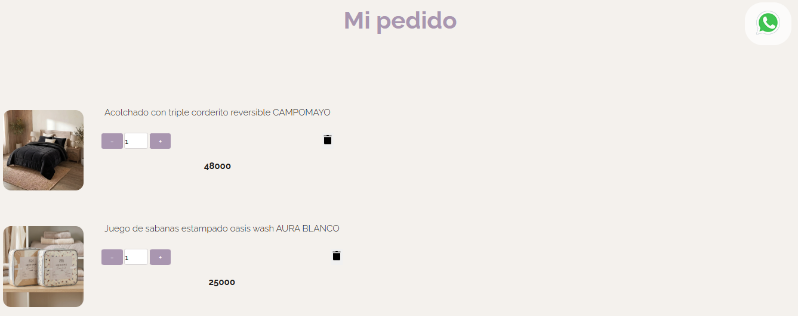
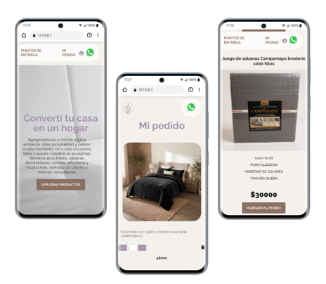

# Serena — Tienda online

Serena es una tienda online desarrollada para facilitar y agilizar las ventas de pequeños emprendedores.

Cuenta con un catálogo de productos y un carrito de compras que permite gestionar precios y cantidades, agregar o eliminar artículos y generar pedidos personalizados. Su objetivo no es procesar pagos desde la plataforma, sino automatizar la preparación y el envío de un mensaje completo, claro y organizado a través de WhatsApp, con el detalle de los productos que el cliente desea comprar.

### Funcionalidades principales

- Catálogo de productos.
- Carrito de compras dinámico.
- Gestión de productos, precios y cantidades.
- Agregado y eliminación de artículos antes de confirmar el pedido.
- Generación automatizada de pedidos para WhatsApp.
- Conexión directa con WhatsApp.
- Carrusel interactivo.
- Diseño responsive, adaptable a diferentes dispositivos.
- Persistencia de datos mediante LocalStorage.

### Tecnologías utilizadas

- HTML5
- CSS3
- JavaScript

## Capturas del proyecto

### Versión de escritorio

### Versión móvil
